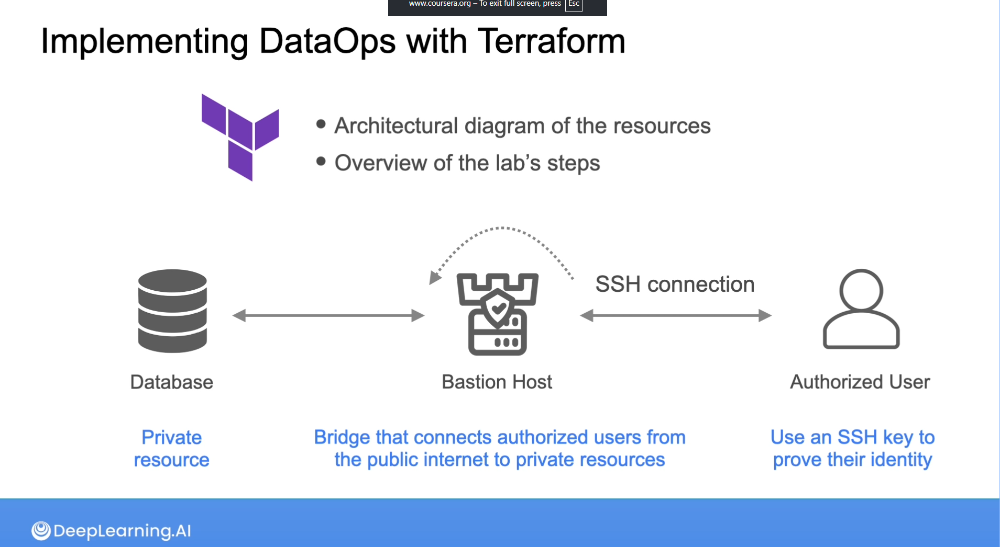
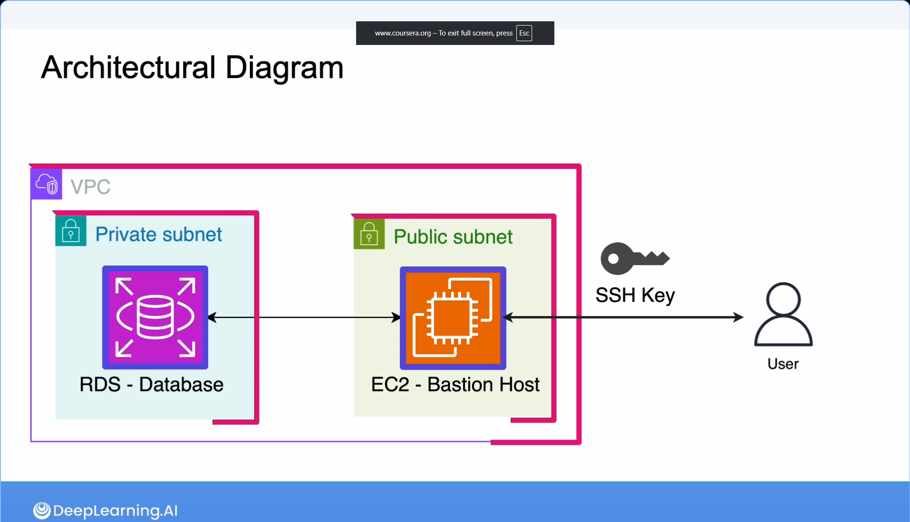
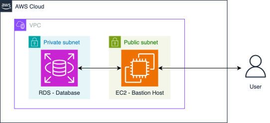
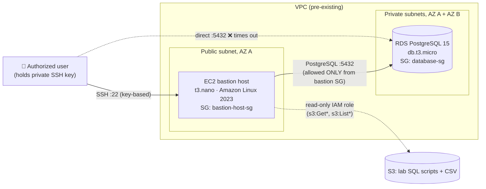
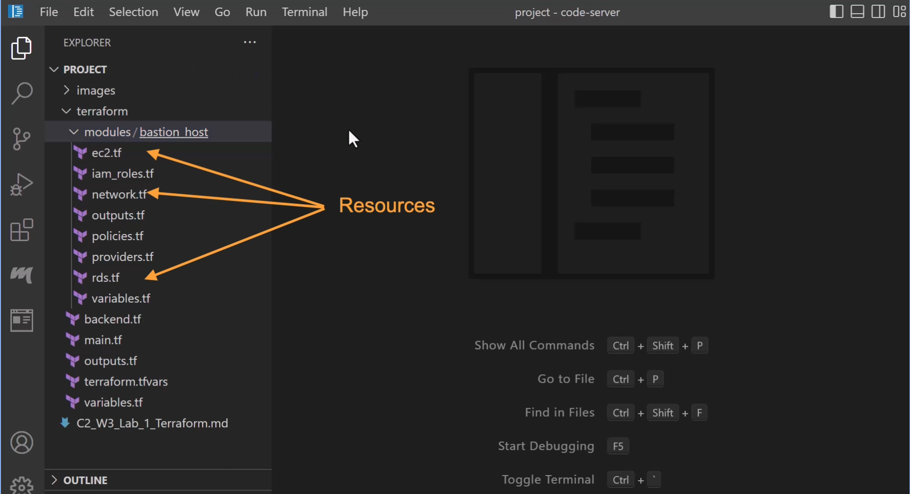
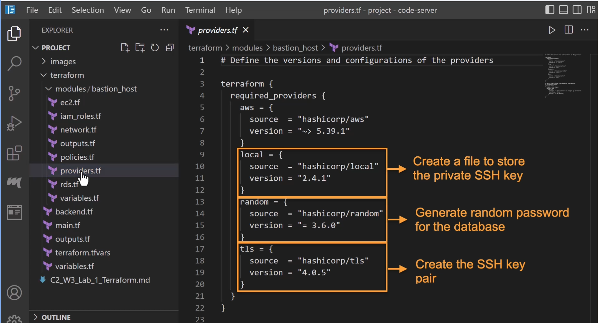
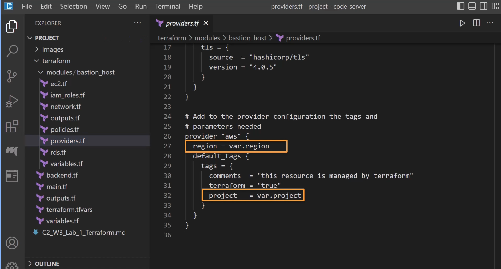
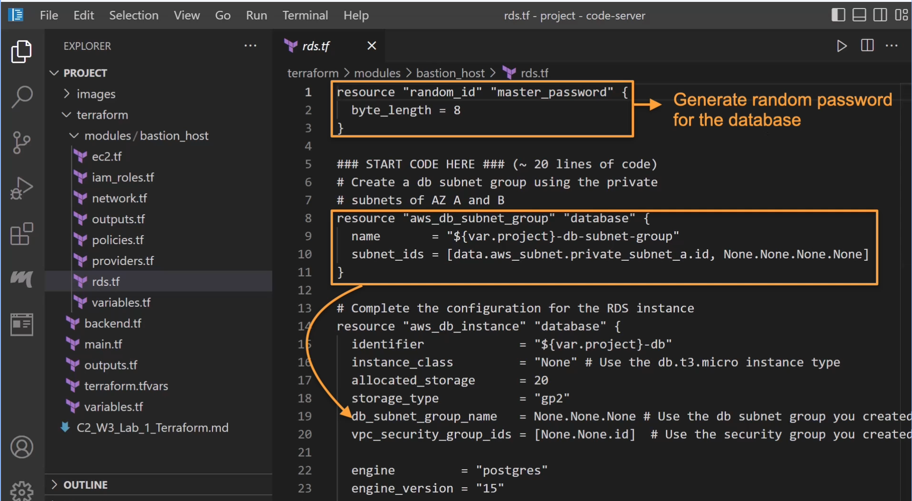
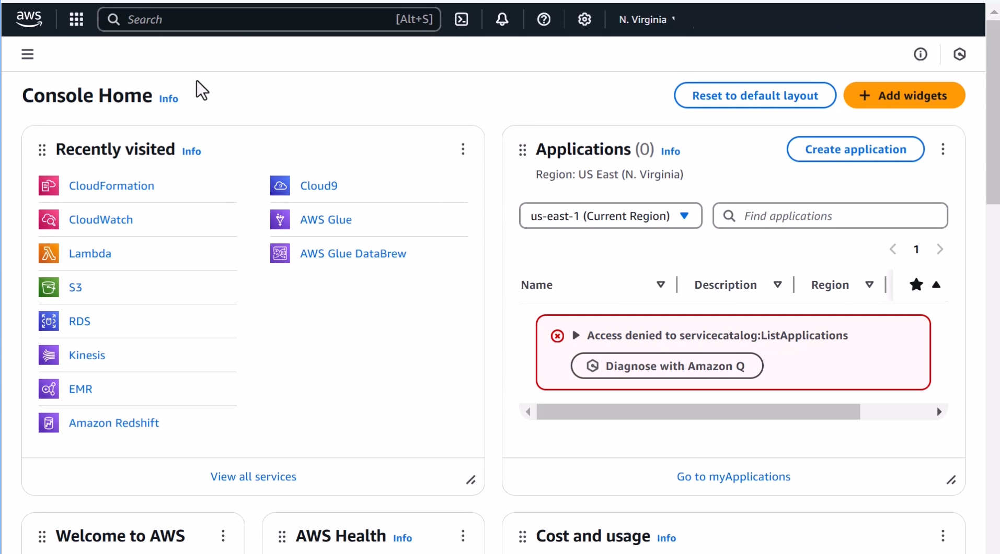
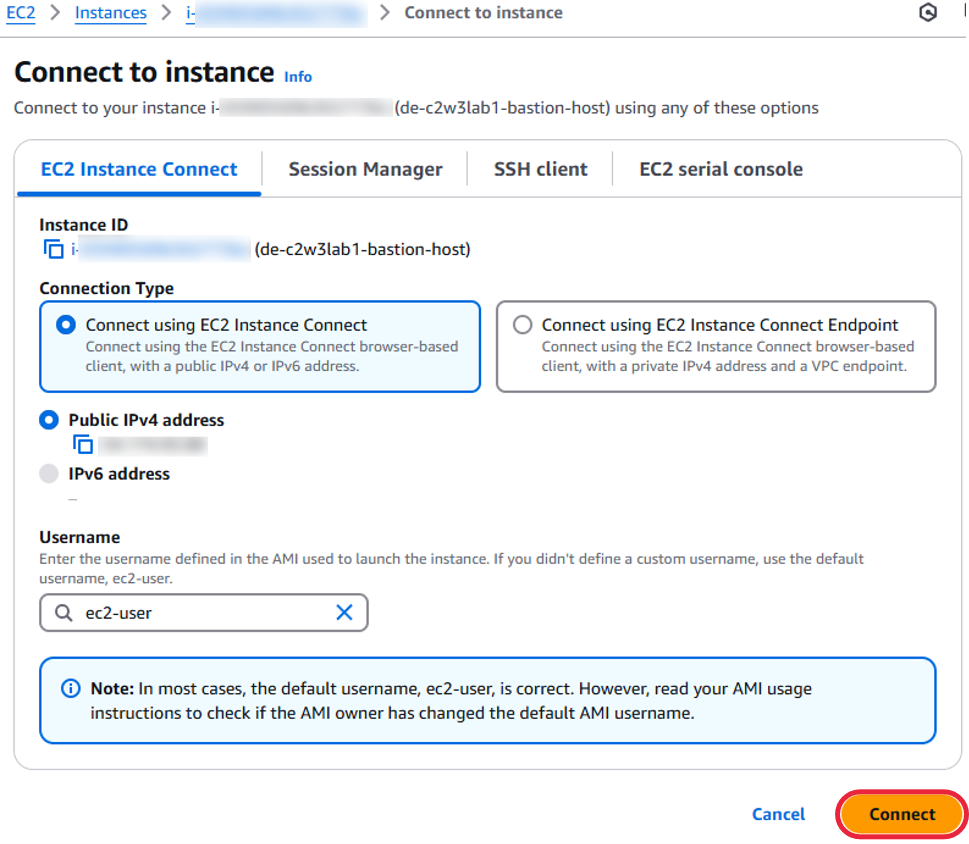

# DataOps with Terraform: Private PostgreSQL on AWS RDS behind a Bastion Host

[](https://github.com/rajm5113/terraform-bastion-host-rds/actions/workflows/terraform-ci.yml)


This repo holds my **Infrastructure as Code** for a common data engineering
pattern: a **PostgreSQL database in a private subnet** that nobody can reach
from the internet, plus a **bastion host (jump server)** that authorized users
reach over SSH to get to the database.

I wrote this as part of the hands-on lab *"Implementing DataOps with
Terraform"* in the **DeepLearning.AI Data Engineering Professional Certificate**
(Course 2, Week 3: DataOps). I wrote the Terraform configuration, deployed it
to a real AWS account, connected to the private database through the bastion
host, loaded a CSV dataset into PostgreSQL, and then tore everything down with
one command.

---

## Table of Contents

1. [What this project does](#1-what-this-project-does)
2. [Architecture](#2-architecture)
3. [What gets provisioned](#3-what-gets-provisioned)
4. [Repository structure](#4-repository-structure)
5. [Code walkthrough](#5-code-walkthrough)
6. [Security design decisions](#6-security-design-decisions)
7. [How to deploy it](#7-how-to-deploy-it)
8. [Connecting to the private database and loading data](#8-connecting-to-the-private-database-and-loading-data)
9. [Tear down](#9-tear-down)
10. [Skills demonstrated](#10-skills-demonstrated)
11. [What I would improve for production](#11-what-i-would-improve-for-production)
12. [Credits](#12-credits)

---

## 1. What this project does

| | |
|---|---|
| **Problem** | A database that holds business data should never be exposed to the public internet, but engineers still need a controlled way to query it, load data and debug. |
| **Solution** | Put the database (Amazon RDS for PostgreSQL) in **private subnets**. Put a small EC2 **bastion host** in a public subnet. Allow database traffic **only from the bastion host's security group**, and require an **SSH key** to log into the bastion. |
| **How** | Everything is declared in **Terraform** (one reusable module, `bastion_host`). Provisioning, changes and teardown are just `terraform apply` / `terraform destroy`. Nothing is clicked together by hand in the console. |
| **Result** | 1 command builds 12 resources (9 of them on AWS) in about 7–10 minutes, a direct connection to the DB times out (private, as intended), a connection through the bastion works, and a ratings dataset is loaded into a `ratings_training` table. |

### The bastion host idea in one picture

<p align="center">
   Bastion Host (bridge) <-> Authorized User (SSH key)" width="850">
</p>

* **Database**: a private resource with no public IP and no internet route.
* **Bastion host**: the only bridge between the public internet and the private network.
* **Authorized user**: proves identity with an **SSH key pair** that Terraform generates.

---

## 2. Architecture

<p align="center">
  
</p>

The VPC and its subnets were **pre-provisioned** (via a CloudFormation stack).
My Terraform code **looks them up as data sources** and creates everything that
runs inside them.

<details>
<summary><b>Detailed AWS diagram (click to expand)</b></summary>
<br>
<p align="center">
  
</p>
</details>

### Traffic flow and security-group rules



---

## 3. What gets provisioned

| Layer | Terraform resource / data source | Purpose |
|---|---|---|
| **Network (looked up)** | `data.aws_vpc.main`, `data.aws_subnet.public_subnet`, `data.aws_subnet.private_subnet_a`, `data.aws_subnet.private_subnet_b` | Reference the existing VPC and subnets by ID instead of hard-coding them |
| **Firewall** | `aws_security_group.bastion_host` | Inbound SSH (22) to the bastion |
| | `aws_security_group.database` | Inbound PostgreSQL (5432) **only from the bastion's security group** |
| **Database** | `random_id.master_password` | Generates the DB master password, so no password is ever typed or committed |
| | `aws_db_subnet_group.database` | Places RDS across **two private subnets in two AZs** (an RDS requirement, and ready for Multi-AZ) |
| | `aws_db_instance.database` | PostgreSQL 15, `db.t3.micro`, 20 GB gp2, `publicly_accessible = false` |
| **Bastion host** | `tls_private_key.bastion_host_key_pair` | Generates a 4096-bit RSA SSH key pair |
| | `aws_key_pair.bastion_host_key_pair` | Registers the public key with EC2 |
| | `local_file.ssh_key` | Writes the private key to a local `.pem` file with `0400` permissions |
| | `data.aws_ami.latest_amazon_linux` | Always picks the latest Amazon Linux 2023 minimal AMI |
| | `aws_instance.bastion_host` | `t3.nano` in the public subnet. `user_data` installs the PostgreSQL 17 client and pulls SQL scripts and CSV data from S3 at boot |
| **Identity** | `aws_iam_role`, `aws_iam_role_policy`, `aws_iam_instance_profile` | Lets the bastion read only the lab's S3 bucket (least privilege) |

---

## 4. Repository structure

```
.
├── terraform/                         # Root module: what you run terraform in
│   ├── backend.tf                     # Where Terraform keeps its state (local backend)
│   ├── main.tf                        # Calls the bastion_host module
│   ├── variables.tf                   # Root inputs (project, region, VPC/subnet IDs…)
│   ├── outputs.tf                     # Re-exports module outputs (DNS, DB host, …)
│   ├── terraform.tfvars.example       # Template for environment-specific values
│   ├── .terraform.lock.hcl            # Pinned provider versions + checksums
│   └── modules/
│       └── bastion_host/              # Reusable module with all resources
│           ├── providers.tf           # aws, tls, random, local + default tags
│           ├── variables.tf           # Module inputs
│           ├── network.tf             # Subnet data sources + security groups
│           ├── rds.tf                 # Password, DB subnet group, RDS instance
│           ├── ec2.tf                 # SSH key pair, AMI lookup, bastion EC2
│           ├── iam_roles.tf           # IAM role + instance profile
│           ├── policies.tf            # Trust policy + least-privilege S3 policy
│           └── outputs.tf             # Module outputs (password marked sensitive)
├── scripts/
│   └── show_connection_info.sh        # Prints bastion DNS, DB endpoint and psql command
├── docs/images/                       # Diagrams and screenshots used in this README
└── .github/workflows/terraform-ci.yml # CI: terraform fmt + validate on every push
```

<p align="center">
  
</p>

The **root module** is thin on purpose. It only wires variables into the
`bastion_host` **child module**, where the real resources live. The same module
could be called again for another environment (dev, staging) with different
inputs.

---

## 5. Code walkthrough

### 5.1 Providers: pinned versions and default tags
[`modules/bastion_host/providers.tf`](terraform/modules/bastion_host/providers.tf)

<p align="center">
  
</p>

| Provider | Version | Used for |
|---|---|---|
| `hashicorp/aws` | `~> 5.39.1` | All AWS resources |
| `hashicorp/local` | `2.4.1` | Writing the private SSH key to a file |
| `hashicorp/random` | `= 3.6.0` | Generating the DB master password |
| `hashicorp/tls` | `4.0.5` | Generating the SSH key pair |

The AWS provider gets the region from a variable and applies **default tags**
to every resource, so you can always tell which project a resource belongs to
and that Terraform manages it:

<p align="center">
  
</p>

### 5.2 Variables: no hard-coded infrastructure IDs
[`variables.tf`](terraform/variables.tf) · [`modules/bastion_host/variables.tf`](terraform/modules/bastion_host/variables.tf) · [`terraform.tfvars.example`](terraform/terraform.tfvars.example)

I declared `public_subnet_id`, `private_subnet_a_id` and `private_subnet_b_id`
(all of type `string`) in **both** the root and the module, and passed them
through in `main.tf`. The real IDs are set in `terraform.tfvars`, which is
**git-ignored**. Only a placeholder `.example` file is committed.

### 5.3 Networking
[`modules/bastion_host/network.tf`](terraform/modules/bastion_host/network.tf)

```hcl
data "aws_subnet" "public_subnet" {
  id = var.public_subnet_id
}
data "aws_subnet" "private_subnet_a" {
  id = var.private_subnet_a_id
}
data "aws_subnet" "private_subnet_b" {
  id = var.private_subnet_b_id
}
```

The database security group doesn't trust any IP range. It trusts **only
members of the bastion's security group**:

```hcl
ingress {
  from_port       = 5432
  to_port         = 5432
  protocol        = "tcp"
  security_groups = [aws_security_group.bastion_host.id]
}
```

### 5.4 RDS: from starter template to working code
[`modules/bastion_host/rds.tf`](terraform/modules/bastion_host/rds.tf)

The lab gave me a template with `None` placeholders to fill in:

<p align="center">
  
</p>

My completed version:

```hcl
resource "aws_db_subnet_group" "database" {
  name = "${var.project}-db-subnet-group"
  subnet_ids = [
    data.aws_subnet.private_subnet_a.id,
    data.aws_subnet.private_subnet_b.id,
  ]
}

resource "aws_db_instance" "database" {
  identifier             = "${var.project}-db"
  instance_class         = "db.t3.micro"
  allocated_storage      = 20
  storage_type           = "gp2"
  db_subnet_group_name   = aws_db_subnet_group.database.name
  vpc_security_group_ids = [aws_security_group.database.id]

  engine         = "postgres"
  engine_version = "15"

  port     = 5432
  db_name  = "postgres"
  username = var.db_master_username
  password = random_id.master_password.hex   # generated, never typed

  publicly_accessible = false                # the whole point
  skip_final_snapshot = true                 # lab environment: fast teardown
}
```

> **Design note:** I used `random_id.master_password.hex` for the password.
> Hex output contains only `0-9a-f`, so it can never include characters RDS
> rejects in master passwords (such as `/`, `@`, `"` or spaces). Base64-style
> encodings can.

### 5.5 Bastion host (EC2)
[`modules/bastion_host/ec2.tf`](terraform/modules/bastion_host/ec2.tf)

```hcl
resource "aws_key_pair" "bastion_host_key_pair" {
  key_name   = "${var.project}-bastion-host-key"
  public_key = tls_private_key.bastion_host_key_pair.public_key_openssh
}

resource "aws_instance" "bastion_host" {
  ami                         = data.aws_ami.latest_amazon_linux.id
  instance_type               = "t3.nano"
  key_name                    = aws_key_pair.bastion_host_key_pair.key_name
  subnet_id                   = data.aws_subnet.public_subnet.id
  vpc_security_group_ids      = [aws_security_group.bastion_host.id]
  associate_public_ip_address = true
  iam_instance_profile        = aws_iam_instance_profile.bastion_host_profile.name
  user_data                   = <<-EOF
    #!/bin/bash
    sudo dnf install postgresql17 -y
    # …downloads sql/ratings_table_ddl.sql, sql/copy_data.sql and
    #    data/ratings_ml_training_dataset.csv from S3
  EOF
  user_data_replace_on_change = true
}
```

At boot, the `user_data` script **bootstraps** the machine: it installs the
`psql` client and EC2 Instance Connect, and downloads the SQL scripts and the
CSV dataset. The host is ready to use as soon as it's running, with no manual
setup.

### 5.6 IAM: least privilege
[`modules/bastion_host/iam_roles.tf`](terraform/modules/bastion_host/iam_roles.tf) · [`modules/bastion_host/policies.tf`](terraform/modules/bastion_host/policies.tf)

The bastion can **only** `s3:Get*` / `s3:List*` on one bucket. It can't write,
delete or reach any other service. No AWS access keys are stored on the
machine. Credentials come from the **instance profile**.

### 5.7 Outputs
[`modules/bastion_host/outputs.tf`](terraform/modules/bastion_host/outputs.tf) · [`outputs.tf`](terraform/outputs.tf)

| Output | Value |
|---|---|
| `bastion_host_id` | EC2 instance ID |
| `bastion_host_dns` | Public DNS of the bastion |
| `db_host` | RDS endpoint address |
| `db_port` | `5432` |
| `db_master_username` | `postgres_admin` |
| `db_master_password` | **`sensitive = true`**: hidden in plan/apply logs, only shown with `terraform output db_master_password` |

---

## 6. Security design decisions

| Decision | Why it matters |
|---|---|
| RDS in **private subnets**, `publicly_accessible = false` | The database has no public endpoint. Internet traffic can't reach it at all. |
| **Security-group chaining** (DB accepts 5432 only from the bastion SG) | Access is tied to *which machine* connects, not to IP ranges that change. |
| **Key-based SSH**, keys generated by Terraform | No shared passwords. The private key file is written with `0400` permissions. |
| **Generated DB password**, output marked `sensitive` | No secret is typed, committed or printed in CI logs. |
| **Least-privilege IAM role** for EC2 | If the bastion were compromised, it could only read one S3 bucket. |
| **Default tags** on every resource | Ownership, cost allocation and "managed by Terraform" are visible in the console. |
| **Nothing sensitive in this repo** | `.gitignore` excludes `*.tfstate`, `*.tfvars`, `*.pem` and `.terraform/`. The AWS account ID in `backend.tf` is masked. |

---

## 7. How to deploy it

> **Prerequisites:** Terraform ≥ 1.5, AWS credentials with permission to create
> EC2/RDS/IAM resources, and an existing VPC with one public and two private
> subnets in different AZs.

```bash
cd terraform

# 1. Provide your network IDs
cp terraform.tfvars.example terraform.tfvars   # then edit the four IDs
# (optional) edit backend.tf to choose where the state file is stored

# 2. Initialise: downloads the 4 providers pinned in .terraform.lock.hcl
terraform init

# 3. Plan: dry run that shows exactly what will be created
terraform plan

# 4. Apply: builds everything (RDS takes ~7-10 min)
terraform apply
```

After `apply`, Terraform prints the outputs. You can show the connection
details at any time with:

```bash
./scripts/show_connection_info.sh                  # password hidden
./scripts/show_connection_info.sh --show-password  # include it
```

<p align="center">
  
  <br><em>The resources are deployed into a sandboxed AWS lab account in <code>us-east-1</code>.</em>
</p>

---

## 8. Connecting to the private database and loading data

### 8.1 Proving the database is private
From outside the VPC, a direct connection **hangs and times out**, which is
exactly what should happen:

```bash
psql -h $(terraform output -raw db_host) -U postgres_admin -p 5432 -d postgres --password
# ... no response -> connection timed out ✅ (RDS is not reachable from the internet)
```

### 8.2 Jumping through the bastion host
I opened a shell on the bastion with **EC2 Instance Connect** (AWS Console →
EC2 → Instances → `de-c2w3lab1-bastion-host` → *Connect*):

<p align="center">
  
</p>

Alternatively, with the generated key:
`ssh -i de-c2w3lab1-bastion-host-key.pem ec2-user@<bastion_host_dns>`

From the bastion, the same `psql` command **connects**, because the request now
comes from inside the bastion's security group:

```bash
psql -h <db_host> -U postgres_admin -p 5432 -d postgres --password
```

### 8.3 Creating the table and loading the dataset

```sql
\i sql/ratings_table_ddl.sql      -- creates the ratings_training table
\i sql/copy_data.sql              -- bulk-loads data/ratings_ml_training_dataset.csv

SELECT * FROM ratings_training LIMIT 10;
SELECT COUNT(*) FROM ratings_training;
\q
```

The SQL scripts and CSV were downloaded to the bastion by `user_data` at boot.
They belong to the course, so they're not in this repo.

---

## 9. Tear down

```bash
terraform destroy
```

One command removes every resource Terraform created (EC2, RDS, security
groups, IAM role, key pair). That keeps costs at zero and leaves no orphaned
infrastructure, which is one of the main benefits of IaC.

---

## 10. Skills demonstrated

- **Infrastructure as Code with Terraform**: modules, input variables, outputs, data sources vs. resources, `tfvars`, local backend and state, provider pinning with a lock file.
- **AWS networking**: VPC, public vs. private subnets, multi-AZ DB subnet groups, security groups and SG-to-SG rules.
- **AWS compute and databases**: EC2 (AMI lookup, `user_data` bootstrapping, instance profiles), Amazon RDS for PostgreSQL.
- **Security**: bastion / jump-host pattern, SSH key-pair authentication, least-privilege IAM, sensitive outputs, keeping secrets out of version control.
- **DataOps practices**: reproducible environments, a full plan → apply → destroy lifecycle, CI checks (`fmt` + `validate`) on every push.
- **Data loading**: connecting with `psql`, running DDL and bulk `COPY`-based ingestion of a CSV into PostgreSQL.

---

## 11. What I would improve for production

This lab is intentionally simple. In a production setting I would:

1. **Remote state**: move from the local backend to an **S3 backend with state locking**, so a team can share state safely.
2. **Restrict SSH**: replace `0.0.0.0/0` on port 22 with the company VPN/office CIDR, or drop SSH entirely in favour of **AWS Systems Manager Session Manager** (no open inbound ports).
3. **Secrets management**: let RDS manage the master password in **AWS Secrets Manager** (`manage_master_user_password = true`) instead of keeping it in Terraform state.
4. **Database hardening**: enable `storage_encrypted`, automated backups, `deletion_protection`, a final snapshot, Multi-AZ, and `gp3` storage.
5. **CI/CD**: extend the GitHub Actions workflow with `tflint`, `checkov`/`tfsec` security scanning, and a `terraform plan` comment on pull requests.
6. **Environments**: reuse the `bastion_host` module for dev, staging and prod with separate `tfvars` and state.

---

## 12. Credits

- Lab: **"Implementing DataOps with Terraform"**, *DeepLearning.AI Data Engineering Professional Certificate* on Coursera (Course 2, Week 3). The starter skeleton, the lab AWS environment, the SQL scripts and the dataset were provided by the course. The completed Terraform configuration, repo organisation, helper script, CI workflow and this write-up are my own work.
- Slide and architecture images in `docs/images/` are © DeepLearning.AI and are used here only to illustrate the lab.

**Author:** Raj · [GitHub @rajm5113](https://github.com/rajm5113)
